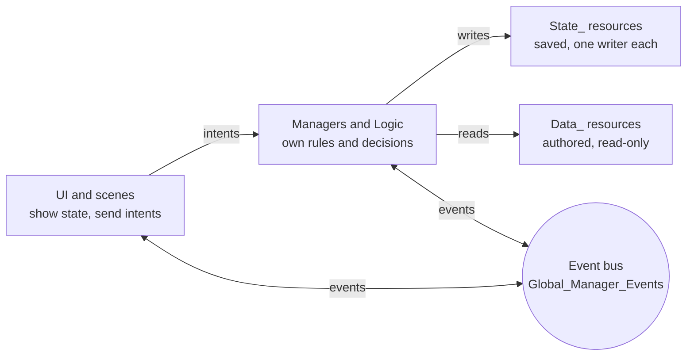

# Architecture and conventions

The structure every game from this base follows. It keeps the foundations (data, event bus, progress, save, input, audio, settings) separate from the game's own mechanic, so supporting systems never have to be refactored around it. `docs/SYSTEMS_MAP.md` shows how the pieces connect.

## Principles

Six rules apply to every system.

1. **Data first.** Anything authored (items, levels, sounds, rumble cues, animation looks) is data, so adding one means adding an entry, not code. Authored data stays read-only at runtime; changing game state lives in separate State resources that the save system writes.
2. **One job, one component.** Focus navigation, hover effects, animators and grids are each built once and instanced wherever needed.
3. **No absolute node paths.** Systems talk through the event bus or through references handed in by the scene root, so a node can move without breaking scripts.
4. **Managers hold logic; UI only displays state and sends intents.** This keeps the interface free to redesign without touching game logic.
5. **Small scenes.** One scene per screen or reusable piece, with no master scene holding everything.
6. **Controller-first.** Every screen is navigable by gamepad from day one, with mouse and keyboard as additional input modes.

## Naming

Names go from the type to the specific, so files group themselves alphabetically.

| Prefix | Used for |
| --- | --- |
| `Global_Manager_` | Autoloads that live for the whole app |
| `Manager_` | Logic inside one scene |
| `Data_` | Authored resources, read-only at runtime |
| `State_` | Runtime state that gets saved |
| `Rule_` | One script per special rule of a game mechanic |
| `Logic_` | Pure functions with no nodes, easy to test |
| `Component_` | Reusable building blocks instanced in many scenes |
| `UI_` and `UI_Animator` | Screen and panel scripts; reusable animation |
| `Shell_` | Title, splash and settings screens |
| `FX_` | Camera and screen effects |
| `Input_Source_` | One gameplay input device |
| `Runtime_` and `Interactable_` | In-world objects |
| `Generate_` | Editor scripts that build resources from CSV |
| `Tool_` and `Debug_` | Developer-only helpers |

Other conventions:

- Files are snake_case (`manager_grid.gd`); class and node names are Pascal_Snake (`Manager_Grid`). A scene and its main script share a name.
- Signals are past-tense events; private members start with an underscore; constants are UPPER_CASE; string ids use StringName (`&"example_tool"`).
- Comments explain why, with sectioned `# === Name ===` headers. Acronyms in names stay capitalized (NPC, SFX, UI).
- Mark untested tuning numbers with `GUESS:` comments. Managers with sound or feedback get a `debug_print` toggle.
- Managers start through explicit `init()` calls in a fixed order (see `main.gd`), not `_ready` order.
- No empty placeholder nodes.

## Folder structure

```text
Assets/    Audio/ (Ambience, Buses, Music, SFX, UI)  Sprites/ (Items, UI)  SVG/  Theming/
Data/      Items/  Rumble/  Audio/ (Cues, Tracks)  UI/ (Animations)  Translations/
Scenes/    Global/  Shell/  Components/  Transitions/
Scripts/
  Data/    Resources/ (data_*.gd)   Generation/ (generate_*.gd)
  Global/  global_manager_*.gd, main.gd
  Managers/  manager_*.gd
  Logic/   logic_*.gd        (no nodes, testable)
  Components/  component_*.gd
  States/  state_*.gd
  UI/      ui_*.gd, shell_*.gd   UI Animations/
  Runtime/ runtime_*.gd, input_source*.gd
  Debug/  Tools/
Shaders/   Screen/  UI/  VFX/  World/
Tests/     one script per boundary check
```

Add folders as the game needs them (for example `Scenes/Overworld/`, `Scripts/Rules/`). Do not keep empty folders the game will never use.

## Data layer

One sheet per data type, exported as CSV, with a `Generate_*` editor script that builds the `.tres` files (see `generate_items.gd`), and translation keys for the languages the game ships (`State_Settings.LOCALES`), with `name_en` kept for reading in the inspector.

- **Readable ids.** Each resource gets a StringName id next to its number, so data can refer to `&"example_tool"` and survive reordering of the sheet.
- **Lookup by id.** `Global_Manager_GameData` keeps a dictionary per type, so any system can fetch a resource directly. Add a `Data/<Type>/` folder, a `get_<type>` function and a loader line for each new type.
- **One writer per state.** Saved state is separate from this data. One save manager writes all `State_` resources together.
- A CSV in `Data/` that is not a translation sheet needs `importer="keep"` in its `.import` file, or Godot treats it as a translation.

## Communication rules



Only managers write state, and systems reach each other through events on the bus, never through node paths.

1. The UI never writes State. It sends an intent event and a manager acts on it.
2. Each State resource has one writer.
3. Managers never call each other directly. They emit and listen on `Global_Manager_Events`, except for parent and child nodes inside one scene, and references handed in by `Main`.
4. Data resources are read-only at runtime.
5. A new cross-system event is added to the bus first, with a one-line description.
6. Separate mechanics never reference each other. Items and flags are the only link.

## Audio, rumble and feedback

- **Sounds and buzzes are data.** `Data_Audio_Cue` and `Data_Rumble_Effect` hold the sound or the strengths, and can name a bus event that fires them. Code says `play(&"menu_confirm")` and never loads files.
- **Audio and rumble listen to the event bus.** Nothing calls them directly, so every trigger can be seen in one place.
- **Menu sounds come from the focus navigator's events**, so no menu wires its own.
- **Hardware is behind one function each** (`Global_Manager_Rumble.backend`, `Global_Manager_SFX.playback_backend`), which is where a console port plugs in.
- **Buses are set by name**, never by index; they are built in code (`Logic_Audio_Buses`).
- **A/B swap is done per controller** by pad name, for menus and for gameplay input.
- **Stretch mode is `canvas_items`**, not `viewport`, so vector art stays sharp on larger displays.

## UI structure

```text
Main (almost empty)
├ Screen_Host     layer 0    current screen, swapped by Global_Manager_Scenes
├ Overlay_Host    layer 10   dialogue, banners, popups
├ Transition      layer 100  fade
└ Debug           layer 128
Each screen scene:
├ its own content
├ Component_Focus_Navigator
└ UI_Animator nodes
```

Flow: the player presses something, the screen sends an intent event, a manager changes State, a state event comes back, and the UI redraws. Overlays open by event, so no screen needs a path to another.

## Build order for a new game

The base already covers the foundations. For a game started from it:

1. **Make the base yours:** rename, fill in `DESIGN.md`, run the tests green.
2. **Your data:** define the data types the game needs, with their CSVs and generators. Test: generate a few and fetch each by id.
3. **Your events and progress:** add the game's events to the GAME block, and extend Progress and its State. Test: do the thing, save, quit, load, and it is still there.
4. **Your mechanic**, on top of the systems above.
5. Everything else the design needs. Each step ends with one boundary test that proves two systems connect, using placeholder art.

## Testing

GUT tests live in `Tests/`. Replace hardware calls (rumble, sound) with recorders so tests need no pad and no audio output. Keep a test's files separate from real user data (use a test path, never `user://save.json`). Prefer polling (`wait_until`) to fixed waits for anything timing-based.
