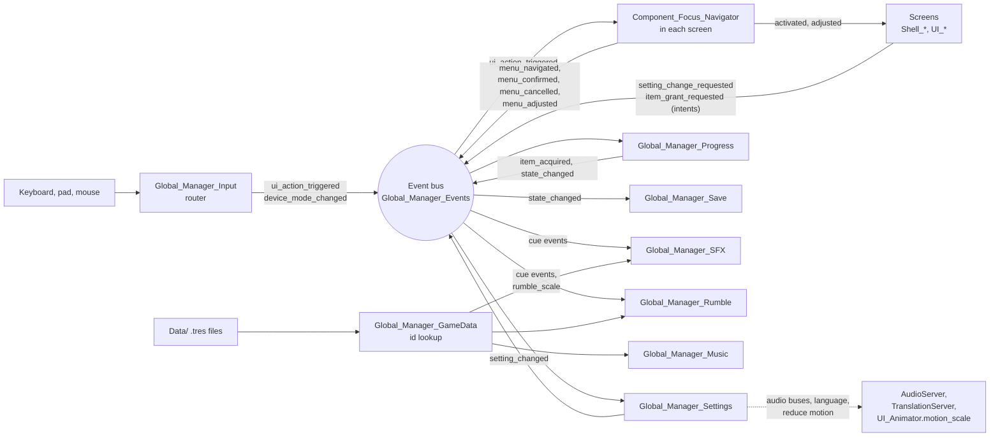

# Systems map

How every piece of the base connects. The rule behind all of it: **systems never call each other.** They send and listen to events on `Global_Manager_Events`. Screens show state and send intents; managers decide and write state.

## The picture



## Start-up order (`Scripts/Global/main.gd`)

`Main` starts everything in a fixed order, not in autoload order, and hands in the references a manager needs:

1. `Global_Manager_Events.init()`
2. `Global_Manager_GameData.init()`: loads every `Data/` resource.
3. `Global_Manager_Progress.init()`
4. `Global_Manager_Save.init([progress state])` then `load_now()`
5. `Global_Manager_Input.init()`
6. `Global_Manager_Rumble.init(device getter)`: the getter asks the active input source for its pad.
7. `Global_Manager_SFX.init()` and `Global_Manager_Music.init()`: create the audio buses and load cues.
8. `Global_Manager_Settings.init()`: loads `settings.json` and applies it to everything above.
9. `Global_Manager_Scenes.init(screen host)`, then the first screen opens.

## Who owns what

| Manager | Owns (the only writer) | Emits |
| --- | --- | --- |
| `Global_Manager_Events` | The list of every cross-system event | none of its own |
| `Global_Manager_GameData` | Reading `Data/`; id to resource lookup | none |
| `Global_Manager_Progress` | `State_Progress` | `item_acquired`, `state_changed` |
| `Global_Manager_Save` | The save file (`save.json`) | `save_completed`, `load_completed` |
| `Global_Manager_Input` | Device mode, last-used pad, held actions | `ui_action_triggered`, `ui_action_held_changed`, `device_mode_changed`, `gamepad_type_changed` |
| `Global_Manager_Rumble` | Master rumble scale; what is buzzing | none |
| `Global_Manager_SFX` | One-shot sound playback | none |
| `Global_Manager_Music` | Music playback, crossfade, ducking | none |
| `Global_Manager_Settings` | `State_Settings` and `settings.json` | `setting_changed` |
| `Global_Manager_Scenes` | The current screen | `scene_changed` |

## Events

Declared in `Scripts/Global/global_manager_events.gd`, in a **BASE** block (reusable) and a **GAME** block (per game).

| Event | Sent by | Heard by |
| --- | --- | --- |
| `ui_action_triggered(action)` | Input | Focus navigators |
| `ui_action_held_changed(action, held)` | Input | Anything drawing a pressed look |
| `device_mode_changed(mode)`, `gamepad_type_changed(type)` | Input | Screens that show button icons |
| `menu_navigated`, `menu_confirmed`, `menu_cancelled`, `menu_adjusted` | Focus navigator | SFX (menu sounds) |
| `setting_change_requested(key, value)` | A screen (intent) | Settings |
| `setting_changed(key, value)` | Settings | Rumble (strength); screens that show settings |
| `rumble_preview_requested` | The settings screen (intent) | Rumble |
| `state_changed(state_key)` | A state's writer | Save |
| `save_completed`, `load_completed(success)` | Save | anything that cares |
| `scene_changed(scene_id)` | Scenes | anything that cares |
| `item_grant_requested(item_id)` (GAME, example) | Anything (intent) | Progress |
| `item_acquired(item_id)` (GAME, example) | Progress | Rumble and SFX cues |

## Data flow

```
spreadsheet -> Data/<Type>/<type>.csv -> Generate_<Type> (editor script) -> .tres files
            -> Global_Manager_GameData (id lookup) -> any system asks by id
```

Data resources are read-only at runtime. Changing game state lives in `State_` resources, each with one writer, saved together by `Global_Manager_Save` (the game save) or `Global_Manager_Settings` (settings, its own file).

## Data-driven cues

Sound cues (`Data_Audio_Cue`) and rumble effects (`Data_Rumble_Effect`) can name a `trigger_event`. At start-up the manager connects the cue to that bus event (through `Logic_Bus_Trigger`), so adding a sound or a buzz means adding a `.tres` file. Nothing calls audio or rumble directly.

## Platform seams

The two functions that touch hardware are replaceable, which is where a console port plugs in:

- `Global_Manager_Rumble.backend`: the only call to `Input.start_joy_vibration`.
- `Global_Manager_SFX.playback_backend`: the only call that starts a voice.

Tests replace both with recorders, so the suite needs no audio output and no pad.

## Where to look

| To change... | Look at |
| --- | --- |
| What a button press means | `Logic_Input_Layout`, `Global_Manager_Input` |
| How a menu moves focus | `Component_Focus_Navigator` |
| How things animate | `UI_Animator` and `Data/UI/Animations/*.tres` |
| A sound or a buzz | `Data/Audio/Cues/*.tres`, `Data/Rumble/*.tres` |
| The settings screen | `Scenes/Shell/shell_settings.tscn` (restyle freely; controls name their setting with `setting_key` metadata) |
| The list of settings | `State_Settings.DEFAULTS` |
